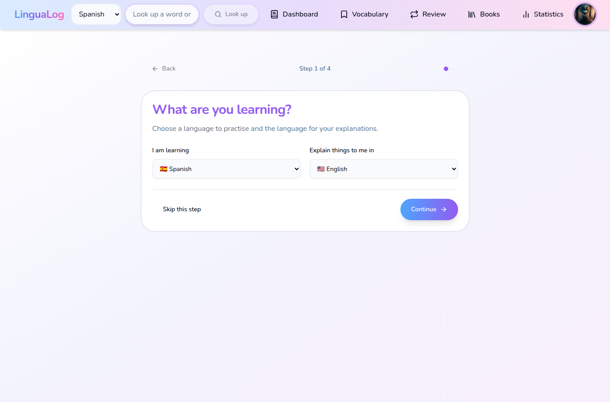
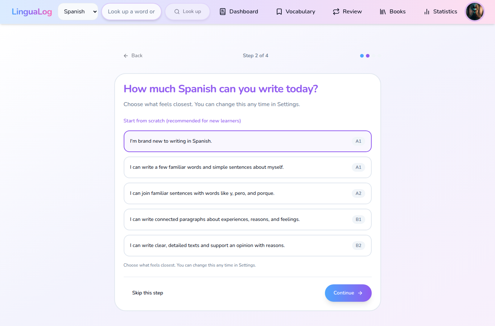
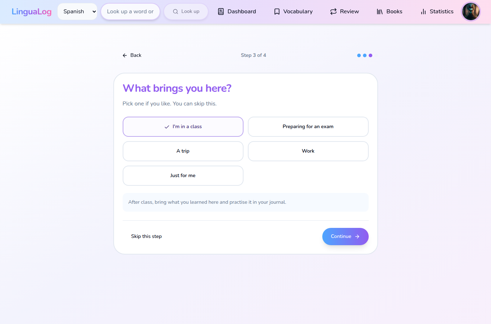
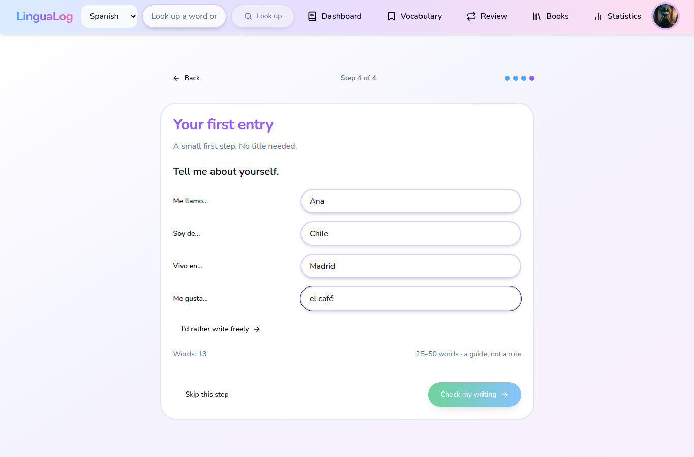
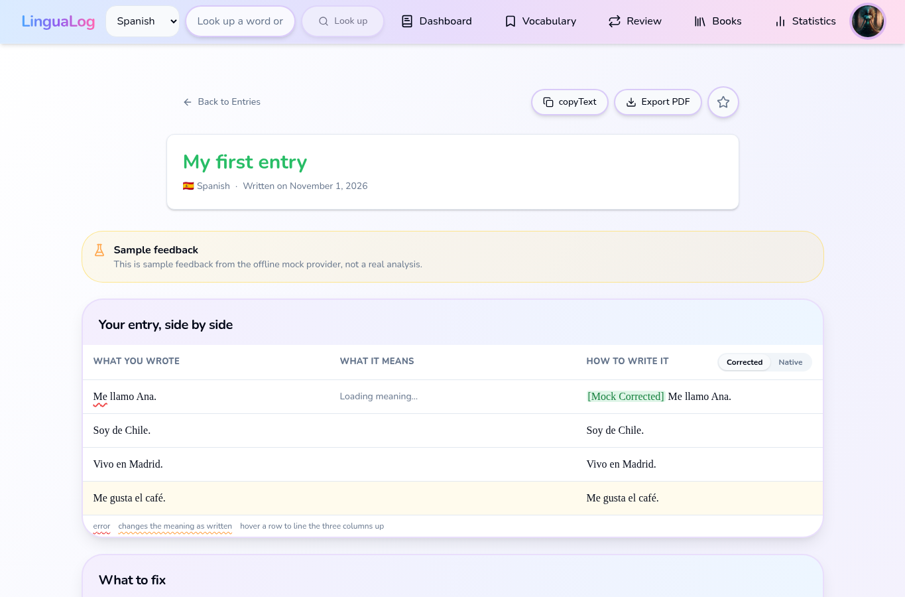

# First-run welcome evidence

Captured from a new account with the offline mock provider. The first image is the destination
after sign-up; the last image is the first corrected-entry destination.

| Screen | Screenshot |
|---|---|
| Sign-up redirect and step 1: language |  |
| Step 2: CEFR self-placement |  |
| Step 3: optional goal |  |
| Step 4: first entry |  |
| Redirect to corrected entry |  |
